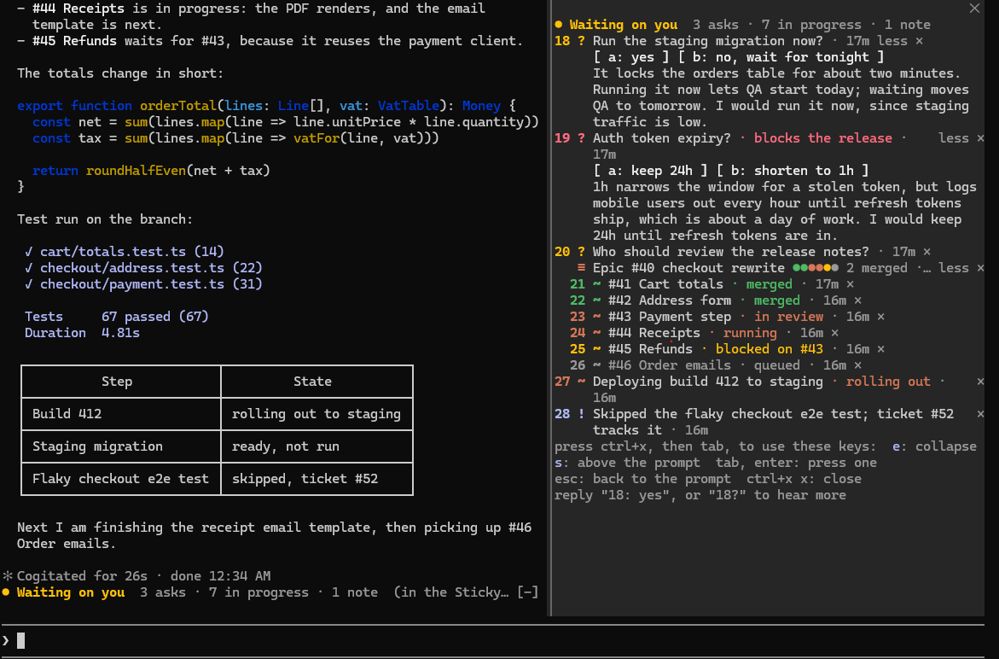

<p align="center">
  
</p>

# sticky

A Claude Code plugin that keeps a board above the prompt with what Claude needs from you, what is still running and
what you should not miss. When you come back to a long session, you read the board and not the transcript.



The picture shows the board moved to the side, with two details and one job opened. A short board sits in a band
above the prompt.

## Install

Run this in Claude Code and answer `y` to add the marketplace:

```text
/plugin install sticky --marketplace serionist/claude-sticky
```

From a shell it is `claude plugin install sticky --marketplace serionist/claude-sticky`. In the desktop app, click
**+** next to the prompt box, then Plugins, Add marketplace with `serionist/claude-sticky`, then Add plugin.

NOTE: sticky was written and tested on Claude Code 2.1.321. The plugin API it uses is early access, so a later release
may break it. Open an issue with your version if it does.

## What goes on the board

Claude pins items as it works, and each one stays until it is settled. There are three kinds:

| Mark | Kind | For |
|---|---|---|
| `?` | ask | something Claude needs from you: a decision, an approval, information only you have or a step only you can do |
| `~` | progress | work that outlasts the turn, such as a deploy or a review it waits for |
| `!` | note | a fact you should not miss, such as a test it skipped |

- Every item has a number. It is given once and never reused in the session.
- An ask can have answers to press, lettered a, b, c.
- An item can have a status in Claude's own words, such as "in review" or "waiting for CI", and a colour for it.
- An item can have a detail of two or three sentences. **more** opens it.
- An item shows its age after a minute. The number of an item Claude pinned jumps to where it was pinned in the
  transcript.
- **×** takes an item off the board.

A job with several parts, such as an epic and its issues, is drawn as one line with a dot per part and a count per
status (`2 merged · 1 in review · 3 queued`). **more** lists the parts.

Background shells are listed by themselves when a turn ends. Subagents are left out, because Claude Code lists them
itself.

## Use it

Answer in your reply with the number: `2: keep them`, or `2b` for the second answer of ask 2. `2?` asks Claude to say
more about item 2. Claude takes an ask off the board when your reply settles it.

You can also press the answers on the board. Press one per ask, then **send**, and they go out as one message of
yours. If Claude is working, the board holds them and sends them when the turn ends. Press **don't send** to take
that back. They are not sent by themselves after a turn you interrupted.

A board of more than 10 lines moves to a pane beside the transcript and comes back when it is short again. `/sticky`
moves it by hand, and `/sticky 3` opens or closes the detail of item 3.

The last row of the board holds its own actions and **keys**. Press `k` there, or click it, to list every key:

| Keys | What they do |
|---|---|
| `ctrl+x`, then `tab` | give the board the keyboard |
| `tab`, `enter` | move to a button and press it |
| `a` | send the answers you pressed |
| `e` | open or close every detail and job |
| `s` | move the board to the side, or back |
| `k` | list the keys, or hide the list |
| `esc` | go back to the prompt |
| `ctrl+x ctrl+a` | hide the band |
| `ctrl+x x` | close the pane |

## Settings

They are in `/config` under the plugin, and all three are on by default.

- `notify` raises a notification when Claude pins an ask and you have not typed or pressed anything for two minutes.
- `catchAsks` has a small model read Claude's reply at the end of each turn and pin up to three questions that Claude
  asked without pinning them. They are marked "from the reply".
- `showKeys` puts **keys** in the last row, which lists the keys when you press `k`.

## What it costs

sticky adds text to what Claude reads, and `catchAsks` makes one model call per turn.

- The system prompt gets a section of about 3,300 characters (some 800 tokens) on how to use the board.
- The two tools, `pin` and `unpin`, are about 3,000 characters (some 750 tokens).
- Each message you type carries the board, one line per item. An empty board adds nothing.
- `catchAsks` is one short Haiku call per turn end. It gets the last 6,000 characters of the reply and answers with at
  most 300 tokens. It runs after the turn, so the turn does not wait for it. `/sticky usage` reports how many
  calls it has made in the session and their tokens.

## What it keeps

The board is saved per session in the plugin's store, a JSON file in your Claude Code configuration folder. Resume
the session and its board comes back. A board is deleted from the store when it is empty, or when its session has
not come back for 60 days.

The text on the board goes into the session's own model requests and nowhere else.

## Limits

- The band draws in the terminal and the desktop app only. The pane draws everywhere.
- The plugin moves a long board to the pane by itself only on a terminal of 144 columns or more (110 after you have
  opened the pane with `/sticky`). On a narrower one the board stays in the band, and `/sticky` still opens the pane.
- A terminal raises a notification at once, through iTerm2, kitty, Ghostty or a plain bell. Only the desktop app can
  hold one until you are away, so the two-minute rule stands in for that.
- The list of background shells is refreshed when a turn ends, not while it runs.
- Answers you press while Claude is working reach it when the turn ends, not during it. A reply you type is read
  during the turn.

These have not been tried in a live session yet: closing the pane by hand, the jump from a number to the transcript,
a board after a real restart, notifications on Windows Terminal, the list of background shells, Claude changing
the status of a job's part, and answers held until a turn ends. [docs/testing-by-hand.md](docs/testing-by-hand.md) has the steps for each.

## Uninstall

Run `/plugin uninstall sticky@sticky`. Saved boards may stay behind in the plugin's store file.

## Developing

```text
git clone https://github.com/serionist/claude-sticky.git
cd claude-sticky
npm ci
node tools/setup.ts
```

`npm ci` installs the pinned dev tools and runs no install script. `node tools/setup.ts` turns on the git hooks.

- `claude --plugin-dir plugin` starts a session with the plugin from your clone and reloads it on each save. Turn the
  installed copy off first with `claude plugin disable sticky@sticky`, or you get two boards.
- `node tools/gate.ts full` runs every check and test.

[CONTRIBUTING.md](CONTRIBUTING.md) is the short path to a pull request and [AGENTS.md](AGENTS.md) has the rules.
[docs/design.md](docs/design.md) says how the plugin works.

## Licence

MIT. See [LICENSE](LICENSE). sticky is not affiliated with Anthropic.
